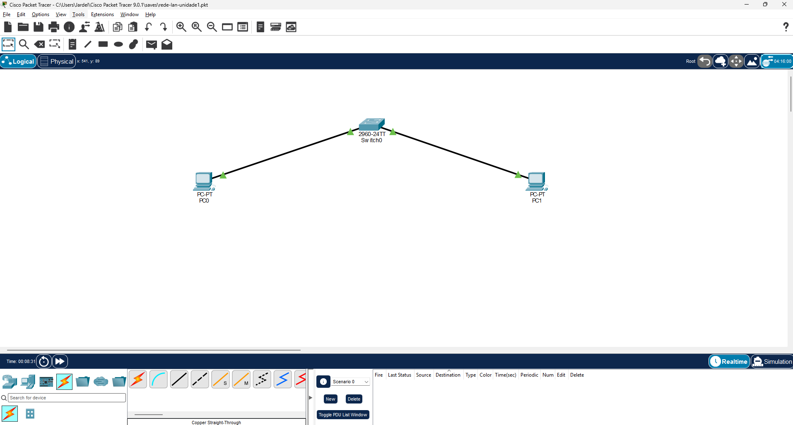
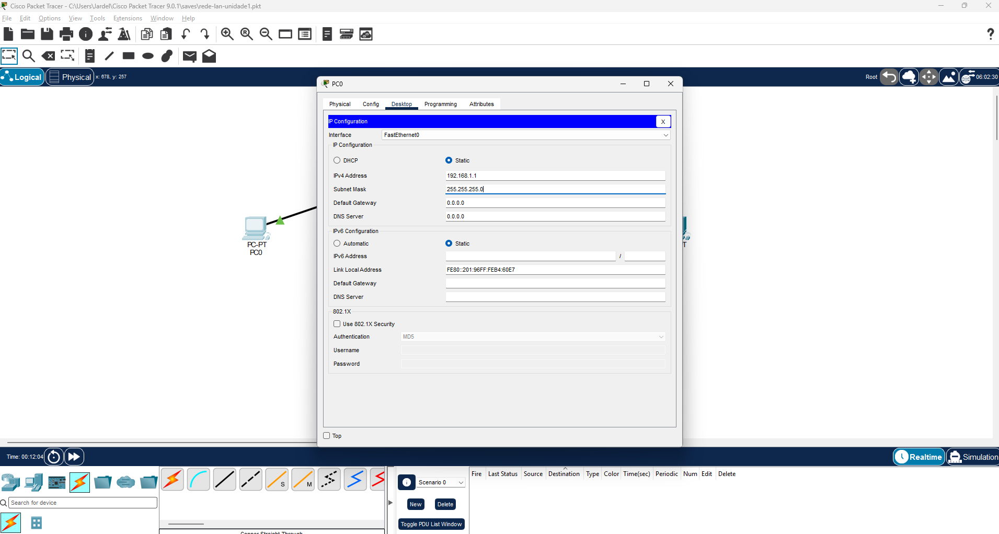
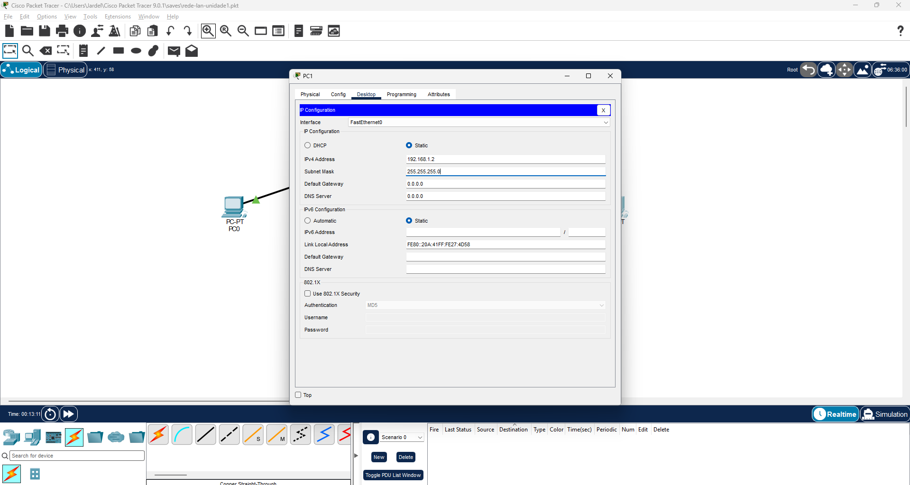
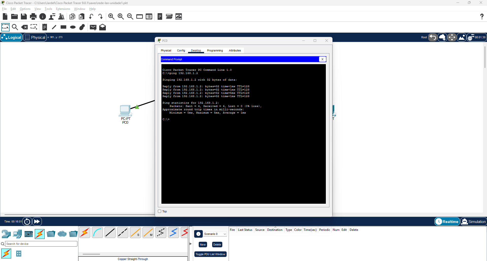

# Rede local com dois computadores e um switch

[← Trabalhos da faculdade](../../README.md) · [Perfil](https://github.com/jardelluizoficial)

Laboratório acadêmico realizado no Cisco Packet Tracer durante a disciplina de Redes de Computadores, do curso de Computação em Nuvem da Anhanguera.

**Unidade:** Fundamentos de Redes de Computadores  
**Aula:** Hardware e Cabeamento  
**Data da prática:** 20/10/2026

**Nesta página:** [Objetivo](#objetivo) · [Configuração](#endereçamento-e-conexões) · [Evidências](#imagens-do-laboratório) · [Resultado](#resultado-do-teste)

## Objetivo

Montar uma rede local simples, configurar os endereços IPv4 dos computadores e verificar a comunicação entre eles usando o comando ping.

## Ambiente utilizado

- Cisco Packet Tracer 9.0.1.
- Dois computadores: PC0 e PC1.
- Um switch Cisco 2960-24TT.
- Dois cabos Copper Straight-Through.
- Topologia em estrela.

## Endereçamento e conexões

| Computador | Endereço IPv4 | Máscara | Interface do PC | Porta do switch |
|---|---|---|---|---|
| PC0 | 192.168.1.1 | 255.255.255.0 | FastEthernet0 | FastEthernet0/1 |
| PC1 | 192.168.1.2 | 255.255.255.0 | FastEthernet0 | FastEthernet0/2 |

Os endereços foram configurados manualmente.

Gateway e DNS não foram necessários para esse teste, pois a comunicação ocorreu por endereço IP entre computadores da mesma sub-rede.

## Procedimentos realizados

1. Adicionei os dois computadores e o switch ao ambiente de simulação.
2. Conectei cada computador ao switch usando um cabo Ethernet direto.
3. Configurei os endereços IPv4 e a máscara de sub-rede.
4. No PC0, abri o Command Prompt e executei `ping 192.168.1.2`.
5. Conferi as respostas e registrei as configurações e o resultado em capturas de tela.

## Imagens do laboratório

### 1. Topologia da rede

Dois computadores conectados ao switch por cabos Ethernet, formando uma topologia em estrela.

### 2. Configuração do PC0

Endereço IPv4: 192.168.1.1. Máscara: 255.255.255.0.

### 3. Configuração do PC1

Endereço IPv4: 192.168.1.2. Máscara: 255.255.255.0.

### 4. Teste de comunicação

No PC0, executei `ping 192.168.1.2`. Os quatro pacotes enviados receberam resposta, sem perdas.

## Resultado do teste

| Indicador | Resultado |
|---|---|
| Pacotes enviados | 4 |
| Pacotes recebidos | 4 |
| Pacotes perdidos | 0 |
| Perda percentual | 0% |
| Tempo médio de ida e volta | 1 ms |

A comunicação funcionou desde a primeira tentativa realizada.

Cálculo da perda: (0 ÷ 4) × 100 = 0%.

## Endereçamento da sub-rede

- Rede: 192.168.1.0/24.
- Broadcast: 192.168.1.255.
- Intervalo de hosts: 192.168.1.1 a 192.168.1.254.
- Total de endereços: 256.
- Endereços utilizáveis para hosts: 254.

## Aprendizados

Nesta prática, exercitei a montagem de uma topologia em estrela, a configuração manual de IPv4 e a interpretação do resultado do ping.

Também compreendi melhor a função do switch na comunicação local e a importância de utilizar endereços IP diferentes dentro da mesma sub-rede.

Caso a comunicação falhasse, começaria conferindo os cabos, as portas utilizadas e as configurações de IP e máscara.

---

[← Voltar ao índice da faculdade](../../README.md) · [Próximo: duas sub-redes com TCP/IP →](../02-tcpip-sub-redes/README.md)
