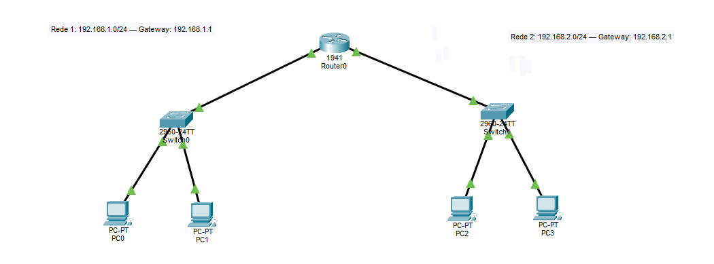
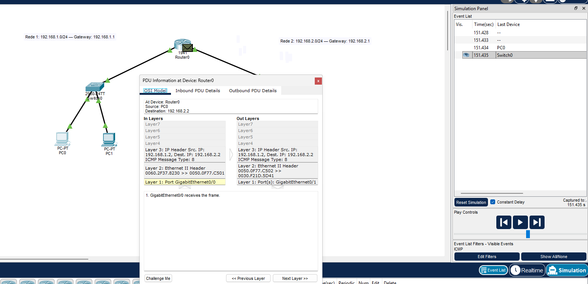

# Conectividade entre duas sub-redes com TCP/IP

Laboratório acadêmico realizado no Cisco Packet Tracer na disciplina de Redes de Computadores, do curso de Computação em Nuvem da Anhanguera.

**Aluno:** Jardel Luiz  
**Unidade 2:** Modelo de Referência ISO/OSI e Arquitetura TCP/IP  
**Aula 2:** Arquitetura TCP/IP  
**Data da prática:** 20/10/2026

## Objetivo e resultado

Configurei duas sub-redes IPv4 conectadas por um roteador. Os quatro PCs alcançaram seus gateways, seus vizinhos locais e os dois computadores da outra rede. Os 16 testes finais registrados terminaram com quatro respostas por destino e 0% de perda. Também observei ARP e ICMP no modo Simulation e simulei uma falha de gateway, seguida de correção e validação.

## Ambiente utilizado

- Cisco Packet Tracer 9.0.1 em Windows.
- Um roteador Cisco 1941, Router0.
- Dois switches Cisco 2960-24TT, Switch0 e Switch1.
- Quatro computadores PC-PT, PC0 a PC3.
- Seis cabos Copper Straight-Through.

## Endereçamento e conexões

Todos os endereços foram configurados manualmente com máscara **255.255.255.0**, equivalente a **/24**.

| Equipamento | Interface | IPv4 | Gateway do PC |
|---|---|---|---|
| Router0 | GigabitEthernet0/0 | 192.168.1.1 | Não se aplica |
| Router0 | GigabitEthernet0/1 | 192.168.2.1 | Não se aplica |
| PC0 | FastEthernet0 | 192.168.1.2 | 192.168.1.1 |
| PC1 | FastEthernet0 | 192.168.1.3 | 192.168.1.1 |
| PC2 | FastEthernet0 | 192.168.2.2 | 192.168.2.1 |
| PC3 | FastEthernet0 | 192.168.2.3 | 192.168.2.1 |

PC0 e PC1 foram ligados ao Switch0; PC2 e PC3, ao Switch1. O Switch0 foi conectado à G0/0 do Router0 e o Switch1, à G0/1. Os switches encaminham os quadros dentro de cada rede local. O roteador encaminha os pacotes entre as duas redes.

## Procedimentos realizados

1. Montei a topologia e conectei os equipamentos.
2. Configurei os endereços das duas interfaces do Router0 e as ativei com `no shutdown`.
3. Conferi `up/up` com `show ip interface brief` e as rotas conectadas com `show ip route`.
4. Configurei IP, máscara e gateway nos quatro PCs.
5. Executei testes para o gateway, o vizinho local e os dois PCs da outra rede, a partir de cada computador.
6. Observei quadros ARP em broadcast e o encaminhamento de um pedido ICMP no roteador.
7. Alterei o gateway do PC0 em uma cópia, registrei a falha remota e restaurei o valor correto.

Os comandos e as portas constam no [roteiro de reprodução](docs/roteiro-pratico.md).

## Testes de conectividade

| Origem | Gateway | Vizinho local | PCs da outra rede | Resultado final |
|---|---|---|---|---|
| PC0 | 192.168.1.1 | 192.168.1.3 | 192.168.2.2 e 192.168.2.3 | 0% de perda em cada destino |
| PC1 | 192.168.1.1 | 192.168.1.2 | 192.168.2.2 e 192.168.2.3 | 0% de perda em cada destino |
| PC2 | 192.168.2.1 | 192.168.2.3 | 192.168.1.2 e 192.168.1.3 | 0% de perda em cada destino |
| PC3 | 192.168.2.1 | 192.168.2.2 | 192.168.1.2 e 192.168.1.3 | 0% de perda em cada destino |

Nas primeiras tentativas de PC0 para PC2 e PC3 houve uma perda por teste, equivalente a 25%. As repetições terminaram com 0% de perda e foram preservadas em uma captura complementar. Os resultados finais e as evidências de cada destino estão na [matriz de testes](resultados/testes-conectividade.csv).

## ARP e ICMP no modo Simulation

O quadro ARP registrado no Switch0 tinha destino MAC `FFFF.FFFF.FFFF`, indicando broadcast. Ele entrou pela Fa0/1 e foi encaminhado pela Fa0/2 e Gi0/1. No evento capturado, o IP de origem e o IP alvo ARP eram ambos `192.168.1.2`; essa captura não representa uma consulta ao gateway `192.168.1.1`.

No Router0, observei um pedido ICMP tipo 8 de `192.168.1.2` para `192.168.2.2`. A entrada ocorreu pela G0/0 e a saída pela G0/1. Os IPs dos computadores foram preservados, enquanto o roteador usou novos endereços MAC para o quadro de saída.

## Incidente de gateway

Com o gateway do PC0 alterado para `192.168.1.254`, PC1 continuou respondendo, mas PC2 apresentou 100% de perda. Depois de restaurar `192.168.1.1`, os dois destinos responderam sem perdas. O [registro do incidente](docs/incidente-gateway.md) reúne a alteração, as evidências, a correção e a validação.

## Endereçamento das sub-redes

Cada /24 contém 256 endereços: 254 utilizáveis para hosts neste laboratório IPv4 convencional. Uma interface do roteador e dois PCs ocupam três endereços em cada rede, deixando 251 endereços de host sem atribuição.

| Rede | Hosts utilizáveis | Broadcast |
|---|---|---|
| 192.168.1.0/24 | 192.168.1.1 a 192.168.1.254 | 192.168.1.255 |
| 192.168.2.0/24 | 192.168.2.1 a 192.168.2.254 | 192.168.2.255 |

## Arquivos e evidências

- [Base funcional para abrir no Packet Tracer](topologia/u2-a2-tcpip-02-base-validada.pkt)
- [Montagem inicial](topologia/u2-a2-tcpip-01-montagem.pkt)
- [Cópia utilizada para observar os pacotes](topologia/u2-a2-tcpip-03-simulacao.pkt)
- [Cópia do incidente após a restauração do gateway](topologia/u2-a2-tcpip-04-incidente-gateway.pkt)
- [Índice das capturas](docs/evidencias.md)
- [Fundamentos e relação com a carreira](docs/fundamentos-e-carreira.md)

Para reproduzir, abrir a base funcional no Packet Tracer e seguir o roteiro. Os arquivos `.pkt` correspondem às versões salvas durante a prática. O relatório acadêmico e o roteiro original da disciplina ficam fora desta pasta pública.

## Aprendizados e continuidade

Pratiquei a sequência de diagnóstico: identificar o sintoma, formular uma hipótese, testar, registrar o resultado, corrigir e validar. A diferença entre comunicação local e remota ajudou a compreender o papel do gateway.

Esse fundamento será retomado nos estudos de redes virtuais e segurança em Azure. A configuração de IP do laboratório não deve ser copiada diretamente para Azure: a plataforma reserva os quatro primeiros endereços e o último de cada sub-rede, incluindo .2 e .3 usados aqui. Uma /24 Azure disponibiliza 251 endereços para atribuição a recursos. [Microsoft Learn](https://learn.microsoft.com/pt-br/azure/virtual-network/virtual-networks-faq).

A conectividade por ping não comprova funcionamento de todas as aplicações nem segurança da rede. Como continuidade em Cloud Security, pretendo estudar políticas de tráfego, como as regras de [grupos de segurança de rede no Azure](https://learn.microsoft.com/pt-br/azure/virtual-network/network-security-groups-overview).

## Referências técnicas

- [Cisco sobre ping e traceroute](https://www.cisco.com/c/en/us/support/docs/ios-nx-os-software/ios-software-releases-121-mainline/12778-ping-traceroute.html)
- [Cisco IOS sobre interfaces e rotas conectadas](https://www.cisco.com/c/en/us/td/docs/ios-xml/ios/ipaddr/command/ipaddr-cr-book/ipaddr-r1.html)
- [Cisco Networking Academy sobre a tabela ARP](https://contenthub.netacad.com/courses/itn-dl/_common/9.2.9-packet-tracer---examine-the-arp-table_es-XL.pdf)
