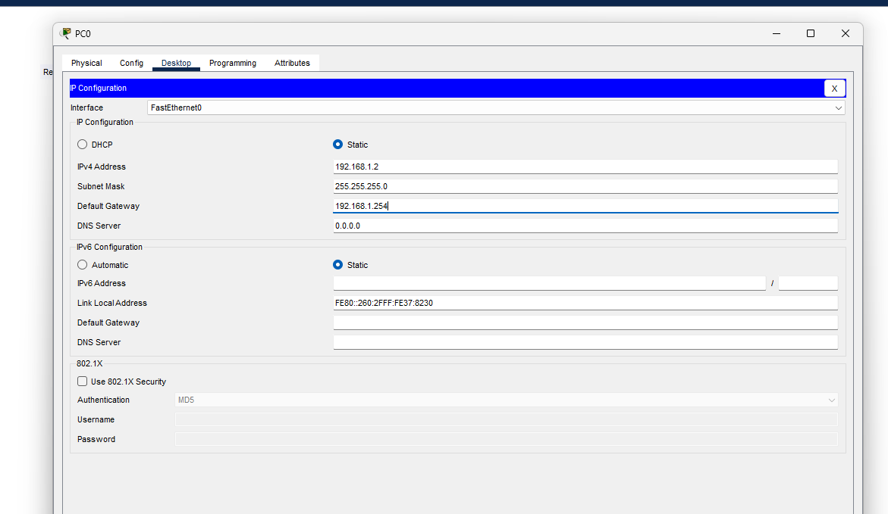
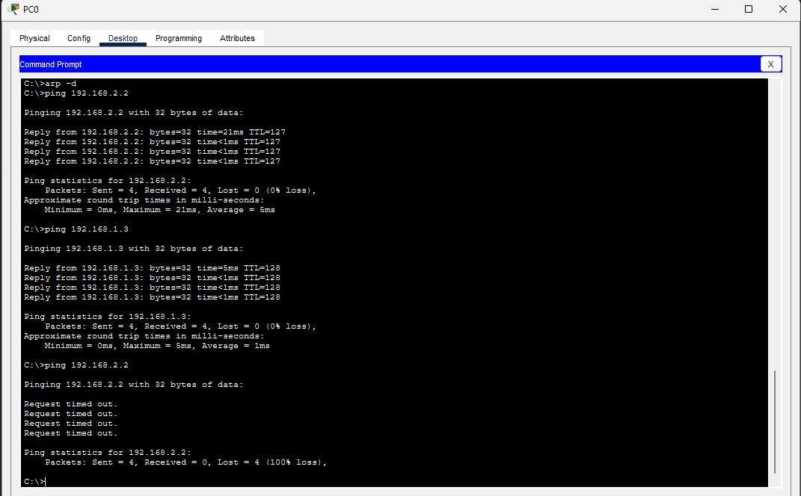
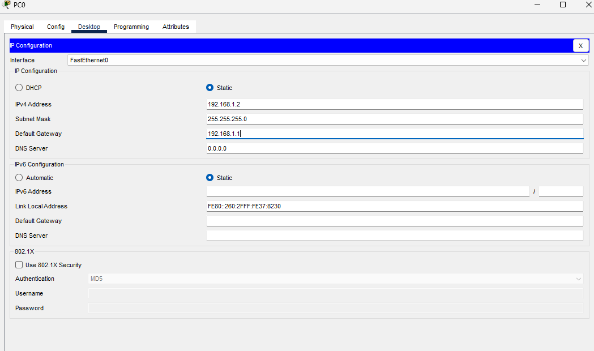
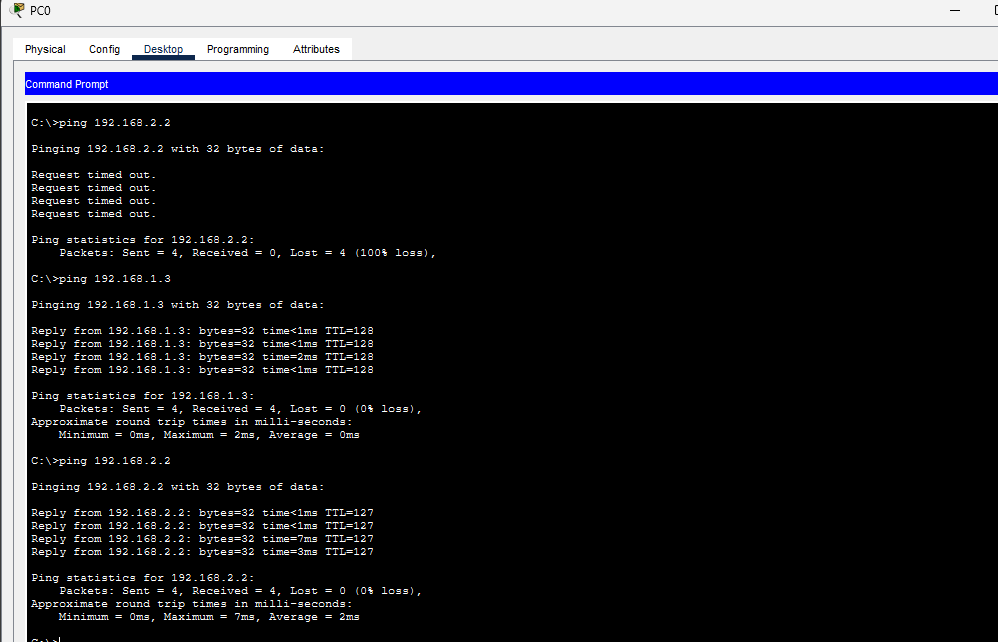

# Incidente com gateway incorreto no PC0

[← Laboratório de duas sub-redes](../README.md) · [Todos os trabalhos](../../../README.md) · [Perfil](https://github.com/jardelluizoficial)

## Sintoma e alteração controlada

Na cópia do laboratório, alterei somente o gateway do PC0 para 192.168.1.254. Mantive IP 192.168.1.2 e máscara 255.255.255.0. O gateway correto era 192.168.1.1. O endereço .254 não correspondia a um roteador nesta simulação.



## Hipótese e testes

A hipótese foi que PC0 manteria comunicação com o vizinho local, mas não alcançaria a outra sub-rede. Executei os mesmos dois comandos durante a falha e após a correção:

```text
ping 192.168.1.3
ping 192.168.2.2
```

| Estado | Destino | Enviados | Recebidos | Perda |
|---|---|---|---|---|
| Gateway 192.168.1.254 | PC1, 192.168.1.3 | 4 | 4 | 0% |
| Gateway 192.168.1.254 | PC2, 192.168.2.2 | 4 | 0 | 100% |
| Gateway restaurado para 192.168.1.1 | PC1, 192.168.1.3 | 4 | 4 | 0% |
| Gateway restaurado para 192.168.1.1 | PC2, 192.168.2.2 | 4 | 4 | 0% |



A captura 18 contém um teste remoto anterior com sucesso. Para observar o incidente, considerar os dois últimos comandos: o teste local responde e o remoto termina com 100% de perda.

## Correção e validação

Restaurei o gateway do PC0 para 192.168.1.1 e repeti os dois pings. Ambos terminaram sem perdas. A cópia do incidente foi salva depois da restauração.





A captura 20 preserva no início o histórico de um teste remoto com falha. Os dois últimos testes, para PC1 e PC2, mostram a validação após a correção, com quatro respostas e 0% de perda.

## Conclusão do diagnóstico

O gateway incorreto impediu a entrega a destinos remotos neste cenário. A comunicação local não dependia dele. A comparação antes e depois da correção confirmou a causa e a recuperação, sem alterar os endereços IP dos PCs.

---

[← Voltar ao laboratório](../README.md) · [Evidências](evidencias.md) · [Roteiro](roteiro-pratico.md) · [Incidente](incidente-gateway.md)
