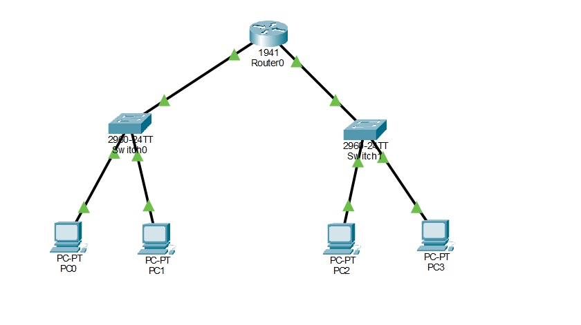
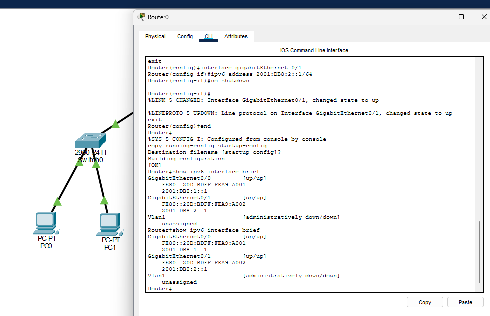
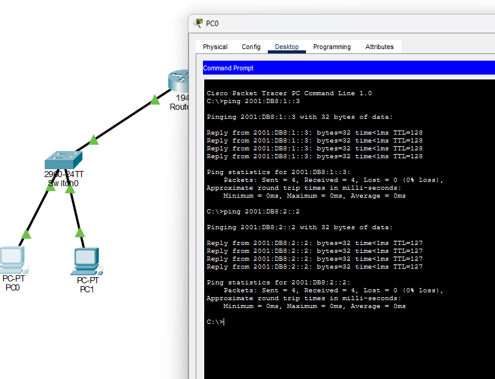

# Conectividade entre duas sub-redes com IPv6

[← Trabalhos da faculdade](../../README.md) · [Perfil](https://github.com/jardelluizoficial)

Laboratório acadêmico realizado no Cisco Packet Tracer na disciplina de Redes de Computadores, do curso de Computação em Nuvem da Anhanguera.

**Aluno:** Jardel Luiz  
**Unidade 3:** Arquitetura e Tecnologias de Redes  
**Aula 4:** Protocolo IPv6  
**Data da prática:** 26/10/2026

**Nesta página:** [Resumo](#objetivo-e-resultado) · [Endereçamento](#endereçamento-e-conexões) · [Configuração](#procedimentos-realizados) · [Testes](#testes-de-conectividade) · [Arquivos](#arquivos-e-evidências)

## Objetivo e resultado

Configurei duas sub-redes IPv6 /64 conectadas por um roteador. Em cada um dos quatro PCs, testei um computador da mesma sub-rede e outro da rede diferente. Os oito testes registrados tiveram quatro respostas por destino e 0% de perda: 32 solicitações enviadas e 32 respostas recebidas.

## Ambiente utilizado

- Cisco Packet Tracer em Windows.
- Um roteador Cisco 1941, Router0.
- Dois switches Cisco 2960-24TT, Switch0 e Switch1.
- Quatro computadores PC-PT, PC0 a PC3.
- Seis cabos Copper Straight-Through.

## Endereçamento e conexões

Todos os endereços foram configurados manualmente com prefixo **/64**. PC0 e PC1 pertencem à rede `2001:DB8:1::/64`; PC2 e PC3, à rede `2001:DB8:2::/64`.

| Equipamento | Interface | IPv6 | Prefixo | Gateway do PC |
| --- | --- | --- | --- | --- |
| Router0 | GigabitEthernet0/0 | 2001:DB8:1::1 | /64 | Não se aplica |
| Router0 | GigabitEthernet0/1 | 2001:DB8:2::1 | /64 | Não se aplica |
| PC0 | FastEthernet0 | 2001:DB8:1::2 | /64 | 2001:DB8:1::1 |
| PC1 | FastEthernet0 | 2001:DB8:1::3 | /64 | 2001:DB8:1::1 |
| PC2 | FastEthernet0 | 2001:DB8:2::2 | /64 | 2001:DB8:2::1 |
| PC3 | FastEthernet0 | 2001:DB8:2::3 | /64 | 2001:DB8:2::1 |

PC0 e PC1 foram conectados ao Switch0; PC2 e PC3, ao Switch1. O Switch0 se conecta à G0/0 do Router0 e o Switch1, à G0/1. O switch encaminha quadros na rede local; o roteador encaminha pacotes entre as duas redes.

O bloco `2001:DB8::/32` é reservado para documentação, conforme a [RFC 3849](https://www.rfc-editor.org/rfc/rfc3849.html). Foi utilizado neste ambiente de simulação, sem conexão à internet.

## Procedimentos realizados

1. Montei a topologia e conectei os equipamentos com cabos Ethernet diretos.
2. Configurei os IPv6 das duas interfaces do roteador e as ativei com `no shutdown`.
3. Habilitei o encaminhamento IPv6 com `ipv6 unicast-routing` e salvei a configuração.
4. Conferi os endereços e o estado `up/up` com `show ipv6 interface brief`.
5. Configurei endereço, prefixo e gateway estáticos nos quatro PCs.
6. Executei os oito testes de ping e salvei as capturas e a simulação.

Os comandos completos e as instruções para repetir os testes estão no [roteiro de reprodução](docs/roteiro-pratico.md).

## Testes de conectividade

| Origem | Destino local | Destino na outra rede | Resultado em cada teste |
| --- | --- | --- | --- |
| PC0 | PC1 · 2001:DB8:1::3 | PC2 · 2001:DB8:2::2 | 4 respostas e 0% de perda |
| PC1 | PC0 · 2001:DB8:1::2 | PC3 · 2001:DB8:2::3 | 4 respostas e 0% de perda |
| PC2 | PC3 · 2001:DB8:2::3 | PC0 · 2001:DB8:1::2 | 4 respostas e 0% de perda |
| PC3 | PC2 · 2001:DB8:2::2 | PC1 · 2001:DB8:1::3 | 4 respostas e 0% de perda |

O teste local verificou a comunicação pelo switch. O teste remoto verificou a comunicação com passagem pelo roteador e o retorno da resposta. A [matriz de resultados](resultados/testes-conectividade.csv) registra cada um dos oito destinos testados e sua evidência.

As capturas dos outros PCs estão no [índice de evidências](docs/evidencias.md).

**Totais:** 4 PCs × 2 testes × 4 solicitações = 32 solicitações. Perda registrada: `(32 − 32) ÷ 32 × 100 = 0%`.

## Prefixo e conceitos praticados

Um endereço IPv6 possui 128 bits. Nesta configuração /64, os primeiros 64 bits identificam o prefixo da rede e os 64 restantes formam o identificador da interface. Os quatro primeiros grupos completos dos prefixos são `2001:0DB8:0001:0000` e `2001:0DB8:0002:0000`. A representação dos endereços e prefixos é descrita na [RFC 4291](https://www.rfc-editor.org/rfc/rfc4291.html).

O gateway é a interface do roteador usada pelo PC para alcançar a outra sub-rede. Atribuir um IPv6 à interface e habilitar o encaminhamento com `ipv6 unicast-routing` são configurações distintas. Também foi necessário ativar fisicamente as portas com `no shutdown`.

O comando ping usa ICMPv6 quando o destino é IPv6. Os testes foram feitos por endereço, portanto não avaliaram resolução DNS. As duas redes estão diretamente conectadas ao Router0; não foi necessário configurar rotas estáticas ou um protocolo de roteamento dinâmico.

## Diagnóstico e limites do experimento

Os enlaces entre os switches e o roteador estavam inicialmente vermelhos. Após a ativação das interfaces, ficaram verdes; a saída do comando de verificação confirmou `up/up`. Os testes de comunicação registrados em seguida não tiveram perda.

Se uma repetição falhar, confira o endereço e o /64 do PC, o gateway, o cabeamento, o estado das interfaces e a habilitação do roteamento IPv6. A comparação entre um destino local e um remoto ajuda a delimitar o problema.

Não foi simulada uma falha de endereço ou gateway neste laboratório. Um endereço diferente do planejado não significa, por si só, perda total de comunicação: o efeito depende da configuração utilizada. Ping bem-sucedido comprova a conectividade nos caminhos testados; não comprova funcionamento de todas as aplicações ou segurança da rede.

## Arquivos e evidências

- [Simulação salva para abrir no Packet Tracer](topologia/rede-ipv6.pkt)
- [Roteiro de reprodução](docs/roteiro-pratico.md)
- [Índice das seis capturas](docs/evidencias.md)
- [Matriz dos oito testes](resultados/testes-conectividade.csv)

O relatório acadêmico em Word e o roteiro original da disciplina ficam fora desta pasta pública, seguindo a organização dos demais trabalhos.

## Aprendizados e continuidade

Pratiquei a configuração manual de IPv6, a interpretação do prefixo /64, a função do gateway e a diferença entre comunicação local e entre redes. Registrei as configurações e os resultados para que a prática possa ser consultada e reproduzida.

Esses fundamentos ajudam no diagnóstico inicial de conectividade em suporte e nos próximos estudos de infraestrutura e redes em nuvem. Como continuidade, pretendo estudar descoberta de vizinhos e autoconfiguração IPv6, que não foram analisadas em capturas específicas nesta prática.

## Referências técnicas

- [RFC 4291 — Arquitetura de endereçamento IPv6](https://www.rfc-editor.org/rfc/rfc4291.html)
- [RFC 3849 — Prefixo IPv6 reservado para documentação](https://www.rfc-editor.org/rfc/rfc3849.html)
- [RFC 8200 — Especificação do IPv6](https://www.rfc-editor.org/rfc/rfc8200.html)

---

[← Anterior: duas sub-redes com TCP/IP](../02-tcpip-sub-redes/README.md) · [Voltar ao índice da faculdade](../../README.md) · [Próximo: gerência de desempenho →](../04-gerencia-desempenho/README.md)
