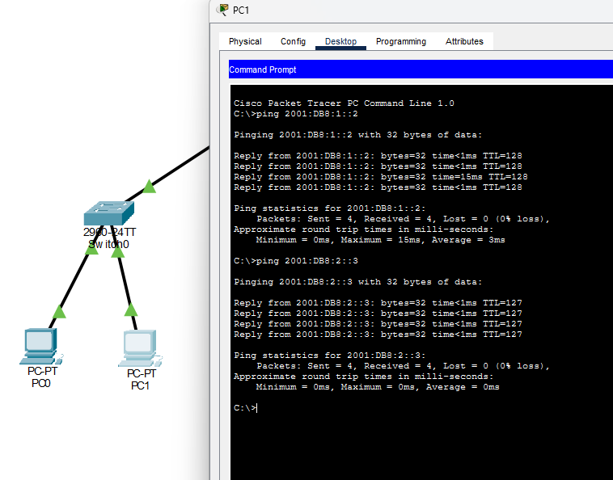
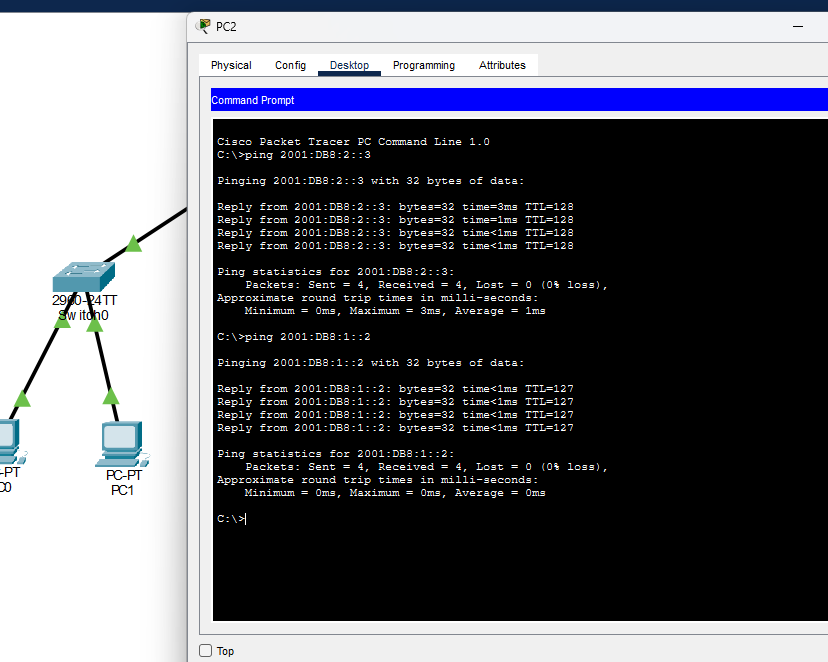
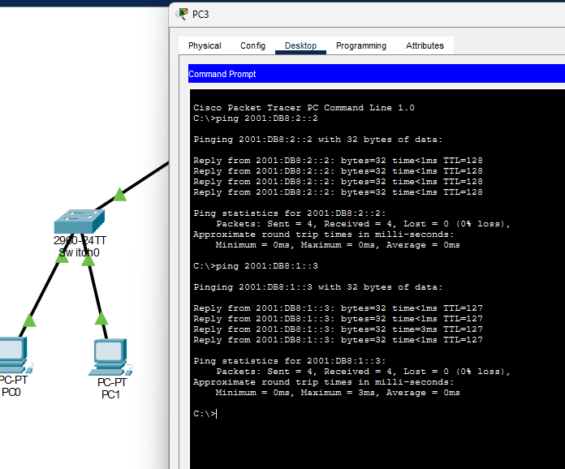

# Evidências da prática IPv6

[← Voltar ao laboratório](../README.md) · [Matriz de testes](../resultados/testes-conectividade.csv)

As seis capturas abaixo foram registradas durante a prática de 26/10/2026. Cada imagem de ping mostra o nome do PC, dois comandos e os resultados. Os oito testes terminaram com quatro respostas e 0% de perda.

## 01 Topologia

Router0 interliga os dois switches, cada um com dois PCs. Todos os enlaces estão ativos.

## 02 Roteador

As interfaces GigabitEthernet0/0 e GigabitEthernet0/1 aparecem em estado `up/up`, com `2001:DB8:1::1` e `2001:DB8:2::1`.

## 03 PC0

Destinos: PC1 (`2001:DB8:1::3`, local) e PC2 (`2001:DB8:2::2`, remoto).

## 04 PC1

Destinos: PC0 (`2001:DB8:1::2`, local) e PC3 (`2001:DB8:2::3`, remoto).

## 05 PC2

Destinos: PC3 (`2001:DB8:2::3`, local) e PC0 (`2001:DB8:1::2`, remoto).

## 06 PC3

Destinos: PC2 (`2001:DB8:2::2`, local) e PC1 (`2001:DB8:1::3`, remoto).

## Escopo da comprovação

As imagens registram a topologia, as duas interfaces do roteador e oito testes de conectividade IPv6. Não documentam testes de DNS, serviços de aplicação, captura de Neighbor Discovery ou falhas provocadas.
