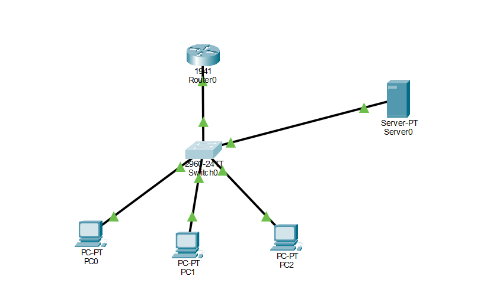
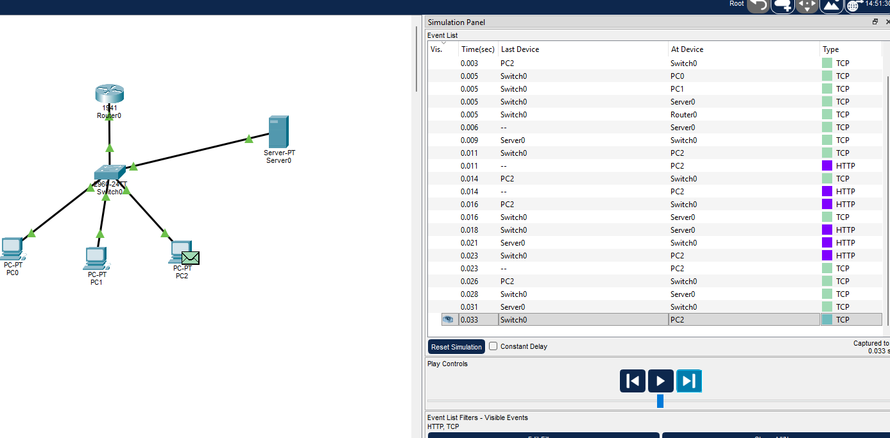
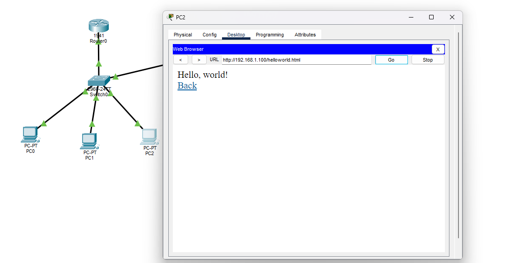
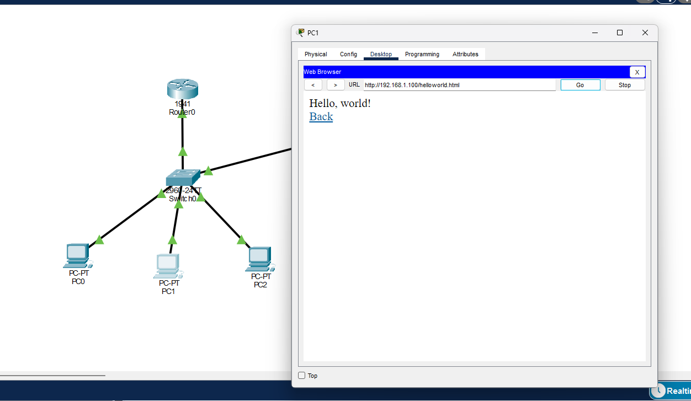

# Análise de desempenho de uma rede IPv4

[← Trabalhos da faculdade](../../README.md) · [Perfil](https://github.com/jardelluizoficial)

Laboratório acadêmico realizado no Cisco Packet Tracer, na disciplina de Redes de Computadores do curso de Computação em Nuvem da Anhanguera.

**Aluno:** Jardel Luiz  
**Unidade 4:** Gerência de Redes  
**Aula 3:** Gerência de Desempenho, Configuração e Contabilização  
**Data da prática:** 28/10/2026

**Nesta página:** [Resultado](#objetivo-e-resultado) · [Endereços](#endereçamento-e-conexões) · [Testes](#testes-e-indicadores) · [Limites](#diagnóstico-e-limites) · [Arquivos](#arquivos-e-evidências)

## Objetivo e resultado

Configurei uma rede local IPv4 com três PCs e um servidor HTTP. Testei a conectividade, acompanhei o percurso de ICMP e HTTP no modo Simulation e consultei os contadores da porta do servidor no switch.

Os três testes de ping tiveram **12 respostas para 12 solicitações e 0% de perda**. O servidor entregou páginas pelo navegador. Em uma captura de simulação, o intercâmbio ICMP levou 7 ms; a resposta HTTP de 62 bytes úteis foi observada em um intervalo definido de 12 ms.

## Ambiente utilizado

- Cisco Packet Tracer em Windows.
- Router0: Cisco 1941.
- Switch0: Cisco 2960-24TT.
- PC0, PC1 e PC2: PC-PT; Server0: Server-PT.
- Cinco cabos Copper Straight-Through.

## Endereçamento e conexões

Todos os endereços são estáticos, na rede **192.168.1.0/24**, com máscara **255.255.255.0**. Os PCs e o servidor usam gateway **192.168.1.1**. O DNS permaneceu em `0.0.0.0`, pois os testes foram feitos por IP.

| Equipamento | Interface | Endereço IPv4 | Porta do Switch0 |
| --- | --- | --- | --- |
| Router0 | GigabitEthernet0/0 | 192.168.1.1 | Gi0/1 |
| PC0 | FastEthernet0 | 192.168.1.2 | Fa0/1 |
| PC1 | FastEthernet0 | 192.168.1.3 | Fa0/2 |
| PC2 | FastEthernet0 | 192.168.1.4 | Fa0/3 |
| Server0 | FastEthernet0 | 192.168.1.100 | Fa0/4 |

O tráfego entre os PCs e o servidor passa pelo switch na mesma rede. A configuração do gateway não transforma esse teste em uma verificação de roteamento entre sub-redes.

## Procedimentos realizados

1. Montei a topologia, conectei os equipamentos e atribuí os endereços.
2. Ativei a G0/0 do roteador, salvei a configuração e confirmei `up/up` com `show ip interface brief`.
3. Conferi `Services > HTTP > On` no servidor.
4. Executei `ping 192.168.1.100` nos três PCs e acessei o servidor pelo navegador do PC1.
5. No PC2, acompanhei ICMP e a solicitação de `/helloworld.html` no modo Simulation.
6. Consultei os detalhes da resposta HTTP e os comandos `show interfaces fastEthernet 0/4` e `show mac address-table` no switch.

O [roteiro de reprodução](docs/roteiro-pratico.md) contém os comandos e o caminho das telas.

## Testes e indicadores

| Observação | Resultado | Evidência |
| --- | --- | --- |
| Ping do PC0 ao servidor | 4/4 respostas, 0% de perda, todas <1 ms | [Captura 07](imagens/07-pc0-ping-servidor.png) |
| Ping do PC1 ao servidor | 4/4 respostas, 0% de perda, todas <1 ms | [Captura 09](imagens/09-pc1-ping-servidor.png) |
| Ping do PC2 ao servidor | 4/4 respostas, 0% de perda; primeira 3 ms, demais <1 ms | [Captura 10](imagens/10-pc2-ping-servidor.png) |
| ICMP no modo Simulation | 0,000 a 0,007 s: 7 ms de ida e volta | [Captura 11](imagens/11-simulacao-icmp-pc2-servidor.png) |
| HTTP no intervalo definido | 0,011 a 0,023 s: 12 ms | [Captura 14](imagens/14-simulacao-http-resposta.png) |
| Corpo da resposta HTTP | Content-Length: 62 bytes | [Captura 16](imagens/16-http-tamanho-conteudo.png) |
| Porta do servidor no switch | Fa0/4, up/up, full-duplex, 100 Mb/s | [Captura 19](imagens/19-switch-fa04-estatisticas-completas.png) |

**Cálculo da taxa útil estimada:** `62 bytes × 8 ÷ 0,012 s = 41.333,3 bit/s ≈ 41,3 kbit/s`.

Esse valor considera apenas o conteúdo útil no intervalo entre o primeiro evento HTTP local do PC2 e a resposta recebida. É uma estimativa de **goodput** nesse recorte, não uma medição da vazão máxima da rede. A capacidade da porta é 100 Mb/s; cabeçalhos, confirmações e o restante do tráfego não estão incluídos no cálculo de conteúdo útil.

### Valores apresentados pela CLI da Fa0/4

| Indicador exibido | Valor |
| --- | ---: |
| Pacotes recebidos | 956 |
| Bytes recebidos | 193.351 |
| Pacotes enviados | 2.357 |
| Bytes enviados | 263.570 |
| Erros de entrada / saída | 0 / 0 |
| Colisões | 0 |
| Reinicializações da interface | 10 |

Os contadores não foram zerados. Na coleta complementar, fiz novos acessos HTTP pelo PC1 e comparei duas leituras: os valores de pacotes e bytes permaneceram iguais. Por isso, esses números não foram tratados como medição dinâmica confiável, e a diferença zero não foi convertida em utilização de 0%. As médias de cinco minutos e as dez reinicializações são valores exibidos pelo simulador, sem causa estabelecida no experimento. Veja as [leituras inicial e final](docs/analise-desempenho.md#verificação-dos-contadores).

As definições, fórmulas e limitações estão na [análise de desempenho](docs/analise-desempenho.md). Os dados também estão em [CSV](resultados/indicadores.csv).

### Experimento complementar: arquivo no PC1 e ICMP periódico

O PC1 também recebeu o arquivo `helloworld.html`, conforme solicitado no roteiro:

Para estimar a contribuição de um fluxo à utilização, configurei um ping periódico de PC2 para Server0, com Size 1000 e intervalo de 1 s. A janela **0 ≤ t < 3 s** contém três solicitações e três respostas. Os detalhes das duas direções confirmam **1.028 bytes por pacote IP**.

| Indicador por sentido | Resultado |
| --- | ---: |
| Volume IP em 3 s | 3 × 1.028 = 3.084 bytes |
| Taxa média IP | 3.084 × 8 ÷ 3 = 8.224 bit/s |
| Parcela da capacidade de 100 Mb/s | **0,008224%** |

Essa é a **utilização estimada referente aos bytes IP deste fluxo**, analisada separadamente em cada direção do enlace full-duplex. Não inclui o custo Ethernet, intervalos entre quadros ou outros tráfegos; portanto, não representa a ocupação física total da porta. O [método, as fórmulas e os tamanhos das PDUs](docs/utilizacao-fluxo-icmp.md) permitem conferir o cálculo.

## Diagnóstico e limites

Em uma tentativa anterior, surgiram eventos TCP sem HTTP. A inspeção mostrou um segmento RST+ACK com sequência antiga, descartado como duplicado. Após reabrir o navegador, fazer uma única solicitação e acompanhar a simulação, registrei a resposta HTTP. A captura não permite afirmar que a causa era congestionamento ou falha física. Veja o [registro do diagnóstico](imagens/12-diagnostico-tcp-descarte.png).

O roteiro acadêmico contém referências divergentes a quantidade de equipamentos, IPv6 e duas sub-redes. Segui a composição e o plano IPv4 detalhados: um switch, três PCs e um servidor na mesma rede /24. A aba de análise de tráfego citada no roteiro não foi localizada no equipamento usado; registrei os indicadores disponíveis pela Event List, detalhes das PDUs e CLI.

Não realizei testes de saturação, segurança, DNS ou roteamento entre redes. Os resultados do ping em Realtime e da Event List são observações distintas. A média de 0 ms mostrada pelo ping reflete sua resolução de apresentação, e não ausência de atraso.

## Arquivos e evidências

- [Simulação original salva no Packet Tracer](topologia/rede-gerencia-desempenho.pkt)
- [Simulação complementar com ping periódico](topologia/rede-gerencia-desempenho-complemento.pkt)
- [Roteiro para repetir a prática](docs/roteiro-pratico.md)
- [Índice das 28 capturas](docs/evidencias.md)
- [Análise e cálculos](docs/analise-desempenho.md)
- [Resultados dos testes de conectividade](resultados/testes-conectividade.csv)
- [Indicadores observados e calculados](resultados/indicadores.csv)
- [Tempos e tamanhos dos três ciclos periódicos](resultados/ping-periodico.csv)
- [Comparação das leituras da CLI](resultados/leituras-contadores.csv)

As 28 capturas e os dois arquivos `.pkt` foram preservados como enviados. O relatório acadêmico em Word e o roteiro original da instituição ficam fora desta pasta pública.

## Aprendizados

Pratiquei a configuração de uma rede IPv4, a verificação de conectividade e do serviço HTTP, a leitura de eventos por camada e a interpretação de contadores. Aprendi a separar capacidade nominal, quantidade de tráfego, tempo de resposta e taxa de conteúdo útil, registrando o que a medição permite concluir.

Essas verificações ajudam a organizar um diagnóstico inicial de suporte: primeiro conferir os endereços e a comunicação por IP; depois testar o serviço e analisar o tráfego observado. A prática também serve de base para os estudos de infraestrutura e redes em nuvem.

---

[← Anterior: duas sub-redes com IPv6](../03-ipv6-duas-sub-redes/README.md) · [Voltar ao índice da faculdade](../../README.md)
