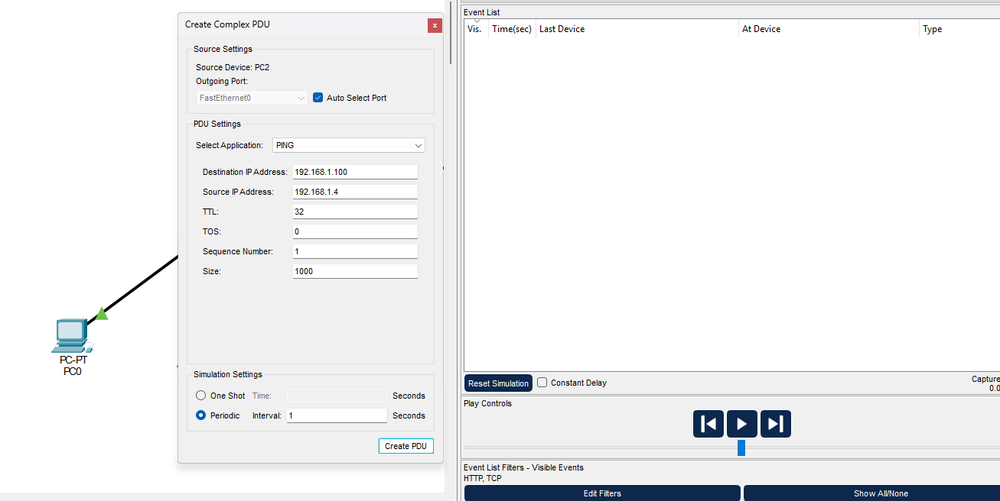
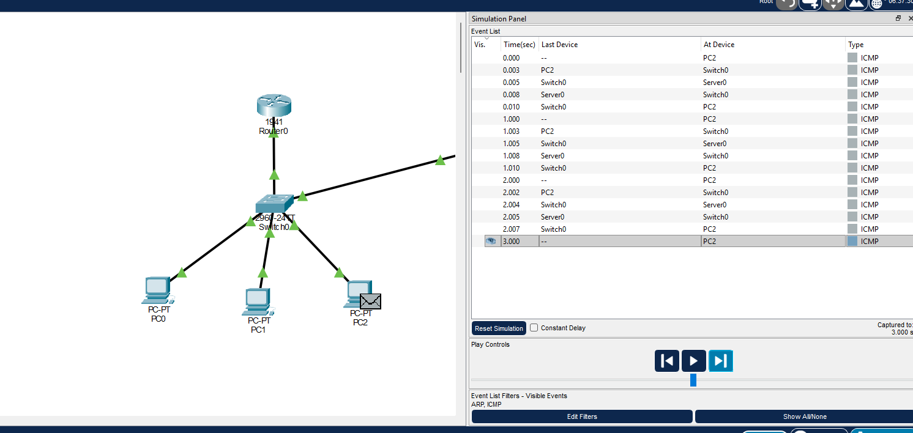

# Estimativa de utilização com ICMP periódico

[← Voltar ao laboratório](../README.md) · [Análise dos indicadores](analise-desempenho.md)

As duas leituras da CLI não atualizaram os contadores após novos acessos HTTP. Para obter uma estimativa baseada em eventos verificáveis, usei um fluxo periódico e os tamanhos das PDUs no modo Simulation. O resultado cobre os bytes IP desse fluxo, sem representar a ocupação física total Ethernet.

## Configuração e janela

| Campo | Valor |
| --- | --- |
| Origem | PC2 — 192.168.1.4 |
| Destino | Server0 — 192.168.1.100 |
| Aplicação | PING |
| Size | 1000 |
| TTL / TOS / Sequence Number inicial | 32 / 0 / 1 |
| Periodic — Interval | 1 segundo |
| Filtros visíveis | ARP e ICMP |
| Constant Delay | Desmarcado |
| Janela analisada | 0 ≤ t < 3 segundos |



O ping simples anterior foi removido. Na janela definida, há três ciclos completos. O início de outro ciclo em 3,000 s fica fora da contagem; cada passagem pelo switch é uma etapa do mesmo pacote.

| Ciclo | Envio no PC2 | Chegada ao servidor | Retorno ao PC2 |
| --- | ---: | ---: | ---: |
| 1 | 0,000 s | 0,005 s | 0,010 s |
| 2 | 1,000 s | 1,005 s | 1,010 s |
| 3 | 2,000 s | 2,004 s | 2,007 s |



## Tamanho confirmado nas duas direções

A [solicitação recebida](../imagens/27-ping-periodico-tamanho-pacote.png) e a [resposta enviada](../imagens/28-ping-periodico-tamanho-resposta.png) pelo Server0 apresentam `IP Total Length = 1028`: 1.000 bytes de dados, 8 bytes de cabeçalho ICMP e 20 bytes de cabeçalho IPv4. A solicitação usa ICMP tipo 8 e a resposta, tipo 0; os IPs de origem e destino se invertem.

Na Fa0/4 do Switch0, as solicitações são **saída para o servidor** e as respostas são **entrada vinda do servidor**. Como o enlace é full-duplex, cada direção é analisada separadamente com capacidade de 100 Mb/s.

## Cálculo por sentido

```text
Volume IP = 3 pacotes × 1.028 bytes = 3.084 bytes
Taxa média IP = 3.084 × 8 ÷ 3 s = 8.224 bit/s
Parcela da capacidade = 8.224 ÷ 100.000.000 × 100 = 0,008224%
```

O mesmo cálculo se aplica às três respostas. Os tempos de ida e volta dos três ciclos foram **10, 10 e 7 ms**, respectivamente. A variação foi observada sem determinar sua causa. O intervalo de 3 s é a janela de observação, não a soma desses tempos. O ICMP simples de 7 ms e os pings em Realtime pertencem a outros testes.

## O que o resultado permite concluir

O fluxo é leve em relação à capacidade nominal. Sua parcela estimada é **0,008224% por sentido, considerando bytes IP**. O cálculo inclui IPv4 e ICMP, mas exclui cabeçalho Ethernet, FCS, preâmbulo, intervalo entre quadros e outros tráfegos. Assim, não mede a ocupação física total da porta nem a utilização de todo o switch. Também não demonstra a vazão máxima sustentada ou comportamento sob congestionamento.

Os [dados em CSV](../resultados/ping-periodico.csv) registram os três ciclos. A [simulação complementar](../topologia/rede-gerencia-desempenho-complemento.pkt) preserva o cenário salvo. Tempos de novas execuções podem variar.
